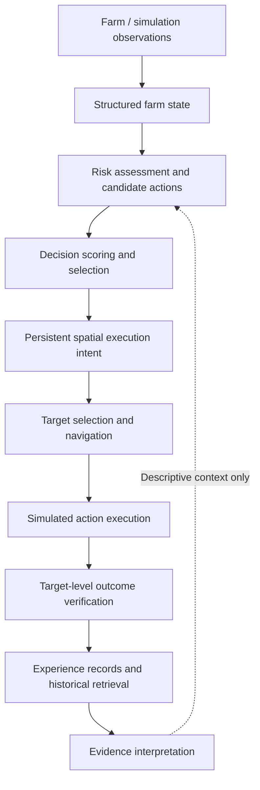

# NEXUS — Engineering Architecture

**Status:** Simulation-validated technical MVP. Real-farm validation pending.

## System overview



## Architectural boundaries

- **Observation and state:** farm conditions are represented as structured inputs to decision making.
- **Decision engine:** generates and scores candidate actions using the current decision policy.
- **Execution:** translates a selected action into a persistent spatial intent, navigation and simulated action.
- **Verification:** checks target-level evidence before counting an action as successful; movement alone is not a successful harvest.
- **Historical intelligence:** stores experiences and retrieves similar records. Retrieved history is currently descriptive and **does not alter the live decision score**.

## Reported reproducible evidence

The project README reports a 720-step simulation with seed 101, recording 719 decisions, 719 experiences and 82 verified successful harvests. It also reports a 324-test regression baseline. These are repository-reported simulation results, **not real-farm outcomes**.

### Reproduce the documented demonstration

```bash
python demo.py
```

Inspect the project README and test suite for prerequisites and the full validation procedure.

## Safety and evaluation questions

1. Does an execution outcome have independently checked target-level evidence?
2. Are decision and action records traceable to the input farm state?
3. Does retrieval change the decision policy unexpectedly? The documented invariance probe reports that it does not.
4. Can the same seed and environment reproduce the reported episode?
5. What changes when moving from simulated observations to noisy real-farm data?

## Planned work (not current capabilities)

- Real-farm observation capture and expert-reviewed recommendations.
- Field pilots and outcome validation.
- Auditable evidence-informed decision policies.
- Optional weather, sensors, communications and operational integrations.

This document describes the documented system boundaries; it does not claim production autonomy or physical robotics.
